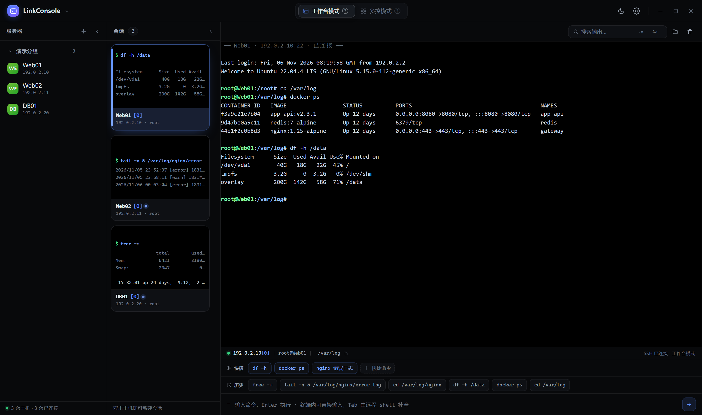
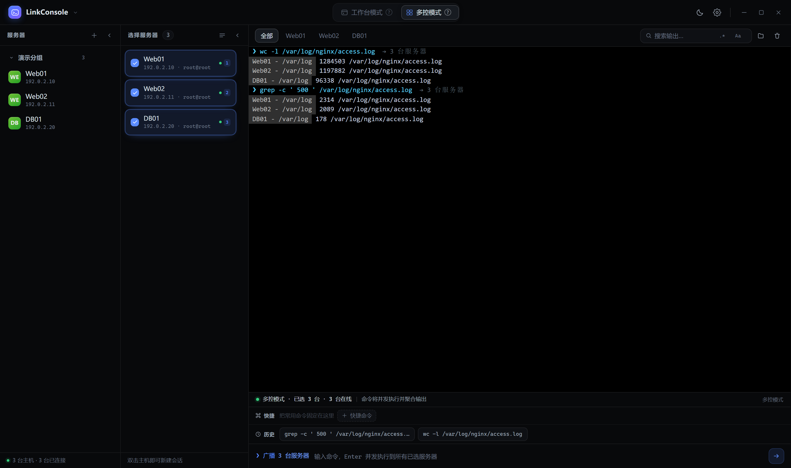
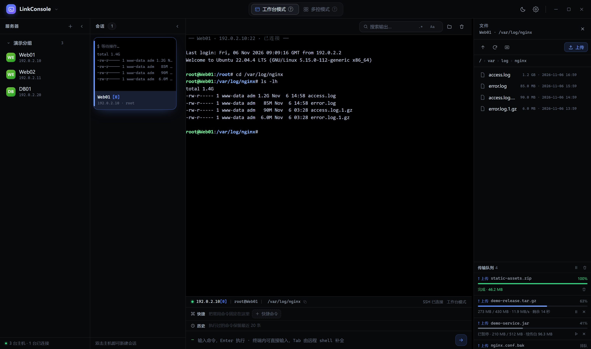
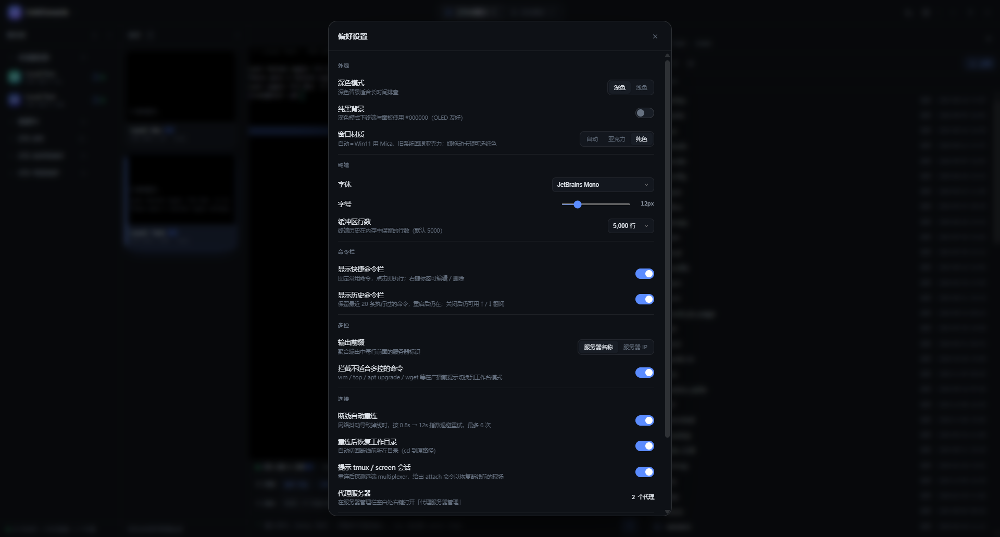

# LinkConsole

> 面向 Linux 运维的 Windows 桌面 SSH 工作台：支持卡片会话预览，多服务器命令批量执行。

<p>  
    
    
    
    
    
</p>

---

## LinkConsole 是什么

LinkConsole 是一个用 **Rust + Tauri 2 + xterm.js** 构建的 Windows 桌面远程服务器管理客户端（SSH / SFTP）。

整个 SSH/SFTP 协议栈是纯 Rust 实现（[russh](https://github.com/warp-tech/russh)），不依赖 PuTTY、OpenSSH 或任何外部可执行文件。

---

## 两种核心模式

顶部开关（或 `Ctrl + Shift + M`）在工作台 / 多控之间切换，两个模式共用会话——切换不重连、不丢上下文。

### 工作台模式 —— 多会话卡片预览，单终端专注操作

类多任务工作台模式，多机卡片预览，专注一个终端：



*中间栏每张卡片是该会话的实时预览（最后执行的命令 + 最近输出，蓝点表示有未读输出），右侧主终端专注操作当前会话；点击卡片即切换，会话不断线、内容不丢失。*

- **会话缩略图**：中间栏每张卡片是真实 xterm 缓冲区的实时文本预览。
- **命令回显**：卡片顶部显示该会话最后执行的命令。
- **单终端专注**：右侧主终端是完整的 xterm.js 终端，256 色 / True Color、5000 行滚动缓冲、正则搜索、Tab 补全；点击任意卡片即切换主终端，会话不断线、内容不丢失。
- **会话管理**：卡片底部显示名称、IP、登录用户；同一主机多会话自动编号 `Web01[0]`、`Web01[1]`；连接握手期间可直接关闭卡片取消连接，后端不残留已建立的 shell。

### 多控模式 —— 指令多机并发执行，聚合输出来源清晰

适合巡检、批量变更、发布窗口这类「N 台机器干同一件事」的场景：



*一条 `wc -l` 同时下发到 3 台主机统计 nginx 访问日志行数，结果按 `[主机 - 当前目录]` 前缀聚合回显，哪台机器多少条一目了然；原本要逐台 SSH的活，一次回车完成。顶部可按主机过滤，只看目标机器的结果。*

- **勾选式批量**：会话栏切换为勾选列表，支持 **Shift 连选 / 连消**，同一主机的多个会话自动合并为一项。
- **一条命令，N 台并发**：底部输入框回车后命令同时下发到所有选中主机。
- **聚合输出，来源清晰**：每行输出带 `[主机名 - 当前目录]` 前缀，能够清晰分辨哪行来自哪台机器；顶部可按主机过滤，只看目标机器的结果。
- **目录跟踪**：命令预测 + 提示符解析 + OSC 7 三路合并，`cd` 之后聚合前缀立即更新，长会话也不会串目录。
- **交互命令拦截**：`vim` / `top` / `htop` / `less` / `passwd` / `apt upgrade` / `mysql` / `tail -f` / `wget` 等全屏交互、需要二次确认或输出持续刷新的命令，在多控下无法正确显示也无法逐台操作——广播前直接拦下并说明原因，可一键**切换到工作台模式**，命令自动填回输入框逐台执行（此拦截可在设置中关闭）。

---

## 文件管理（SFTP）与传输队列



*右侧文件面板浏览 `/var/log/nginx`（目录树 + 面包屑 + 大小 / 修改时间），底部传输队列四态并存：`static-assets.zip` 已完成、`demo-release.tar.gz` 运行中（63% · 11.9 MB/s · 剩余 14 秒）、`demo-service.jar` 已暂停且记录断点（续传自 96.3 MB）、`nginx.conf.bak` 排队等待。*

- 可自定义调节宽度的文件面板，目录树 + 面包屑导航；新建目录、重命名、删除（目录递归）、下载到本地（系统保存对话框）。
- **拖拽上传**：文件或整个目录直接拖进窗口，递归传输；也支持按钮上传。
- **传输队列**：所有上传 / 下载进入面板底部队列**串行执行**，每条任务实时显示**百分比、已传 / 总量、实时速度（如 12.3 MB/s）、剩余时间（如 2 分 31 秒）**。
- **暂停 / 继续 / 取消**：单任务粒度的暂停与继续（进度条冻结、恢复后从原位置继续），随时取消；另有「暂停全部 / 清除已完成」。
- **断点续传**：按两端已有字节数自动续写——取消、网络中断或会话重连后点「重试」即从断点继续，不重传整个文件；远端 / 本地已有完整副本时自动跳过。
- 目录列表带 8 秒缓存，增删改后自动失效，补全与浏览共用同一份数据；切换会话时面板自动跟随，连续点击目录只接受最后一次请求，不会串号。

---

## 断线自动重连与会话恢复

- 连接意外断开（非用户主动关闭）时自动重连：**0.8s → 1.6s → 3s → 5s → 8s → 12s 指数退避，最多 6 次**，可在设置中关闭；卡片显示「重连中 n/6…」，任意时刻关闭卡片即停止重试。
- 重连**复用同一个终端**，历史回滚不丢失；成功后状态栏与卡片立即恢复在线。
- **恢复现场**：重连后自动 `cd` 回断线前的工作目录；若远端有 **tmux / screen 会话**，终端会列出会话名并给出 `tmux attach -t xxx` / `screen -r xxx` 恢复命令（可在设置中关闭提示）。
- 配合习惯：长任务放进 `tmux` 里跑，断网重连后 attach 即可回到原现场，进程不受断线影响。



---

## 技术栈

| 层    | 选型                                                      | 说明                                                                |
| ---- | ------------------------------------------------------- | ----------------------------------------------------------------- |
| 桌面框架 | **Tauri 2**                                             | Rust 宿主 + 系统 WebView2，安装包 ~2 MB，常驻内存远低于 Electron                  |
| 后端语言 | **Rust**（edition 2021，MSVC 工具链）                         | 异步运行于 Tokio，PTY 数据泵与传输任务全部在 Rust 侧                                |
| SSH  | **russh 0.63**（ring 后端）                                 | 纯 Rust SSH 协议栈，无 OpenSSH / libssh 依赖；禁用 aws-lc-rs 以免需要 cmake/nasm |
| SFTP | **russh-sftp 3.0**                                      | 列目录、递归上传下载、进度事件回传                                                 |
| 前端   | 原生 ES Module + **Vite 7**                               | 无框架，模块直接操作 DOM，冷启动与打包体积最优                                         |
| 终端   | **xterm.js 5.5** + Fit / Search / WebLinks 插件           | 256 色、正则搜索、链接识别                                                   |
| 窗口增强 | `tauri-plugin-decorum`、`window-vibrancy`、`webview2-com` | Snap Layout、Mica                                                  |

---

## 安装

### 方式一：安装包（推荐）

1. 从 [Releases](../../releases) 下载 `LinkConsole_1.0.0_x64-setup.exe`。
2. 双击安装（当前用户级安装，无需管理员权限）。
3. 首次启动会自动检测 WebView2 运行时；缺失时安装器会联网下载引导程序。

> 也可直接使用免安装的 `linkconsole.exe`，放到任意目录运行即可。

**系统要求**：Windows 10 1809+ / Windows 11（x64），WebView2 Runtime（Win11 自带，Win10 多数已随 Edge 安装）。

### 方式二：从源码构建

**环境准备**

| 依赖               | 版本                  | 备注                                        |
| ---------------- | ------------------- | ----------------------------------------- |
| Node.js          | 18+                 | 前端构建                                      |
| Rust             | 1.77.2+             | `rustup` 安装，工具链选 `x86_64-pc-windows-msvc` |
| MSVC C++ 生成工具    | VS 2022 Build Tools | 勾选「使用 C++ 的桌面开发」与 Windows SDK             |
| WebView2 Runtime | 最新                  | 运行期依赖                                     |

**一键构建并运行**

```bat
:: 构建发布版并启动
build-and-run.bat

:: 开发模式（Vite 热重载 + Tauri 窗口）
build-and-run.bat dev

:: 直接运行已构建的 exe
build-and-run.bat run

:: 清理构建产物
build-and-run.bat clean
```

**手动构建**

```bash
npm install
npm run tauri build          # 产物：src-tauri/target/release/linkconsole.exe
                             #       src-tauri/target/release/bundle/nsis/LinkConsole_1.0.0_x64-setup.exe
```

首次编译 Rust 依赖约需 3–5 分钟，之后增量构建通常在 30 秒内。构建产物：

| 产物       | 路径                                                                     |
| -------- | ---------------------------------------------------------------------- |
| 单文件 exe  | `src-tauri\target\release\linkconsole.exe`                             |
| NSIS 安装包 | `src-tauri\target\release\bundle\nsis\LinkConsole_1.0.0_x64-setup.exe` |

---

## 快捷键

| 快捷键                           | 功能                       |
| ----------------------------- | ------------------------ |
| `Ctrl + N`                    | 新建主机                     |
| `Ctrl + T`                    | 为当前主机新建会话                |
| `Ctrl + B`                    | 打开 / 关闭文件面板              |
| `Ctrl + ,`                    | 偏好设置                     |
| `Ctrl + Shift + M`            | 切换 工作台 / 多控 模式           |
| `Ctrl + F`                    | 终端搜索（支持正则、区分大小写）         |
| `Tab`                         | 输入框：呼出补全；终端内：发送给远程 shell |
| `↑` / `↓`                     | 输入框：历史命令                 |
| `Ctrl + C`                    | 终端内 = 中断信号（不复制）          |
| `Ctrl + V` / `Shift + Insert` | 粘贴                       |
| 选中后右键                         | 复制选中文本                   |
| 双击主机                          | 快速新建会话                   |

---

## 数据与日志位置

| 内容                                | 路径                                                |
| --------------------------------- | ------------------------------------------------- |
| 配置（主机 / 分组 / 代理 / 快捷命令 / 历史 / 设置） | `%APPDATA%\com.linkconsole.app\linkconsole.json`  |
| 主机密钥指纹库（OpenSSH 格式）               | `%APPDATA%\com.linkconsole.app\known_hosts`       |
| 运行日志（> 1 MiB 自动重建）                | `%LOCALAPPDATA%\LinkConsole\logs\linkconsole.log` |

---

## 项目结构

```
LinkConsole/
├── build-and-run.bat          # 一键构建 / 运行 / 清理
├── index.html                 # 应用外壳（三栏布局 + 弹窗容器）
├── package.json
├── vite.config.js
├── src/                       # 前端（原生 ES Module）
│   ├── main.js                # 入口：配置加载、事件装配、演示参数
│   ├── api.js                 # Tauri IPC 桥接（浏览器下退化为 mock 后端）
│   ├── state.js               # 全局状态与配置持久化、旧数据迁移
│   ├── term.js                # xterm 宿主管理、主题、缩略图渲染、重排
│   ├── sessions.js            # 会话生命周期、会话卡片、断线自动重连
│   ├── multi.js               # 多控聚合、前缀、过滤、广播
│   ├── cwd.js                 # 远端当前目录跟踪（命令预测 / 提示符 / OSC 7）
│   ├── servers.js             # 服务器树、主机与代理管理
│   ├── files.js               # SFTP 文件面板、拖拽传输、可拖拽调宽
│   ├── workspace.js           # 状态栏、快捷命令栏、输入行、搜索、快捷键
│   ├── settings.js            # 偏好设置 / 关于
│   ├── ui.js                  # 统一菜单与弹窗组件
│   ├── window.js              # 自定义标题栏与窗口控制
│   ├── native-menu.js         # 原生菜单桥接
│   ├── desktop.js             # 桌面行为收敛（加速键、编辑菜单、拖拽）
│   ├── styles.css / theme.css # 布局与主题
│   └── ...
├── src-tauri/                 # Rust 后端
│   ├── src/ssh/session.rs     # SSH 连接、PTY、输出泵（合帧 + 增量 UTF-8）
│   ├── src/ssh/known_hosts.rs # 主机密钥 TOFU 指纹库
│   ├── src/sftp.rs            # SFTP 传输内核（队列任务 / 暂停 / 取消 / 断点续传）
│   ├── src/net/proxy.rs       # SOCKS5 / HTTP CONNECT 握手 + SSH 跳板机（JUMPHOST）转发
│   ├── src/store.rs           # 配置原子读写
│   ├── src/menu.rs            # 原生菜单构建与事件回传
│   ├── src/desktop.rs         # WebView2 收敛、Mica / 亚克力材质
│   ├── src/logging.rs         # 文件日志
│   ├── src/commands.rs        # Tauri 命令层
│   └── tauri.conf.json
└── tools/gen-icons.js         # 纯 Node 生成应用图标（无第三方依赖）
```

**IPC 命令**：`store_load` `store_save` `app_info` `ssh_connect` `ssh_write` `ssh_resize` `ssh_close` `ssh_exec_quiet` `session_cwd` `probe_cwd` `sessions_of` `net_probe` `net_probe_proxy` `sftp_list` `sftp_mkdir` `sftp_remove` `sftp_rename` `sftp_start_upload` `sftp_start_download` `sftp_pause_transfer` `sftp_resume_transfer` `sftp_cancel_transfer` `reveal_local` `default_download_dir` `host_key_forget` `popup_menu` `set_window_material`

**事件**：`ssh-data`（终端输出）、`ssh-cwd`（目录变更）、`ssh-closed`（断连）、`sftp-progress`（传输进度与状态：running / paused / done / cancelled / error）、`native-menu`（原生菜单点击）

---

## 开发与构建

```bash
# 前端独立调试（浏览器打开 http://localhost:1420，后端自动 mock）
npm run dev

# 桌面端开发（Vite HMR + Tauri 窗口）
npm run tauri dev

# 仅构建前端
npm run build

# 重新生成应用图标（修改 tools/gen-icons.js 中的配色/字形后执行）
npm run icons
```

前端在浏览器中运行时会自动降级为 mock 后端：可以完整走通建主机、开会话、多控广播、SFTP 列表、传输队列（含暂停 / 取消）等交互，便于改 UI 而不必反复编译 Rust。URL 参数 `?demo=three&mode=multi` 等可快速构造演示数据（仅内存，不写入配置）；`?demo=three-wshot / three-mshot / three-fshot` 为 README 三张截图的演示场景。

---

## 常见问题

**启动后白屏 / 报 WebView2 缺失**  
安装 [Microsoft Edge WebView2 Runtime](https://developer.microsoft.com/microsoft-edge/webview2/)，或改用带引导程序的安装包。

**`npm run tauri build` 失败，提示找不到 `link.exe` 或 Windows SDK**  
未安装 MSVC C++ 生成工具。安装 Visual Studio Build Tools 2022，勾选「使用 C++ 的桌面开发」。

**编译 `russh` 时提示缺少 cmake / nasm**  
本项目已关闭 `aws-lc-rs` 默认特性、改用 `ring` 后端，正常不会触发。若自行改动了 features，请恢复为 `default-features = false, features = ["flate2", "ring", "rsa"]`。

**多控前缀目录不更新**  
目录跟踪优先使用命令预测与提示符解析，`cd` 一般可即时识别；若使用自定义 PS1（如只显示 `\W` 短名）或 `sudo su` 切换用户，建议在远端 shell 开启 OSC 7（如 `PROMPT_COMMAND='printf "\033]7;file://%s%s\033\\" "$HOSTNAME" "$PWD"'`）。

**窗口透明但背景发黑 / 花屏**  
显卡或远程桌面场景下 Mica 可能不可用，程序会自动回退亚克力或纯色；也可在偏好设置中手动选择「纯色」。

---

## 贡献

欢迎 Issue 与 PR。提交前请确保：

1. `npm run build` 通过，`cargo check --manifest-path src-tauri/Cargo.toml` 无警告；
2. 不引入新的联网依赖或遥测；
3. 代码风格与现有模块保持一致（前端原生 ESM、Rust `cargo fmt`）。

---

## 许可证

[MIT](LICENSE) © 2026 LinkConsole
